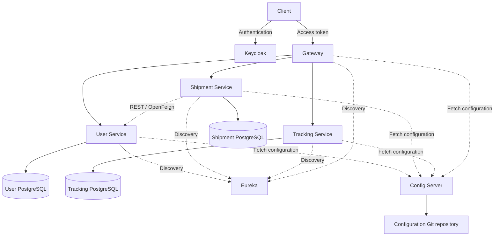

# FlowShip

FlowShip is a logistics and shipment-tracking platform built as a hands-on microservices engineering project. It starts small and grows as concrete business and architectural problems justify new capabilities.

> Business problem → architecture decision → implementation → testing → failure scenario → next capability

## Current status

**Phase 0 — Project initialization.** This repository currently contains documentation and a starter directory structure. No application services or infrastructure have been implemented yet.

The first technical milestone is deliberately small:

```text
Git-backed configuration repository
                ↓
Spring Cloud Config Server
                ↓
Tiny Spring Boot client
```

Repository hosting and the separate `flowship-config` repository will be connected manually. There are no build or run commands yet.

## Business idea

Customers will create shipments, provide sender and receiver information, choose an origin and destination, and view shipment status and tracking history. Couriers will later manage assigned deliveries and report progress. Operations administrators will manage workflows and investigate delivery failures.

A typical shipment lifecycle is:

```text
CREATED → PICKED_UP → IN_TRANSIT → OUT_FOR_DELIVERY → DELIVERED
```

Additional states may include `CANCELLED`, `FAILED_DELIVERY`, and `RETURNED`. Allowed transitions and actor permissions will be defined when shipment behavior is implemented.

## Initial services

| Service | Owns | Initial responsibilities |
| --- | --- | --- |
| User Service | Business user profiles | Create, retrieve, and update profiles; manage user status |
| Shipment Service | Shipment information and lifecycle | Create and retrieve shipments, list user shipments, validate participants, update status |
| Tracking Service | Shipment history | Store and retrieve tracking events; later consume shipment events |

Keycloak will own authentication identities, credentials, roles, and tokens. User Service will own business profile data and **must never store passwords**.

Each service owns its database. Cross-service references use identifiers and explicit API or event contracts, never shared JPA entities, direct table access, or database foreign keys across services.

## Planned architecture



This diagram describes a planned architecture, not a running system. See [architecture](docs/architecture/overview.md) for ownership, communication, security, and operational decisions.

## Technology goals

The project will explore Spring Boot, Spring Cloud Config, Eureka, Spring Cloud Gateway, REST and OpenFeign, Keycloak with OAuth2/OIDC and JWT, Resilience4j, PostgreSQL, Redis, and Kafka.

Operational work will cover Actuator, Prometheus, Grafana, Loki, OpenTelemetry, Tempo, Dockerfiles, Spring Boot Buildpacks, Google Jib, Docker Compose, Kubernetes, Helm, and CI/CD.

Testing will grow from JUnit and Mockito to API tests, Testcontainers integration tests, and eventually Playwright workflows when a user-facing application exists. Every component must have a clear reason for existing and an interview-ready explanation of its trade-offs.

## Development roadmap

| Phase | Capability |
| --- | --- |
| 0 | Repository structure and documentation |
| 1 | Centralized configuration with a working client |
| 2 | Eureka service discovery |
| 3 | User Service with PostgreSQL, validation, and tests |
| 4 | API Gateway |
| 5 | Keycloak authentication and service authorization |
| 6 | Shipment and Tracking services |
| 7 | REST/OpenFeign service communication |
| 8 | Failure handling and resilience |
| 9 | Redis, when a concrete use case exists |
| 10 | Kafka and asynchronous shipment events |
| 11 | Metrics, logs, and distributed tracing |
| 12 | Compare Dockerfile, Buildpacks, and Jib images |
| 13 | Reproducible Docker Compose environment |
| 14 | Kubernetes resources and operations |
| 15 | Helm packaging |
| 16 | CI/CD and deployment smoke tests |

See the [detailed roadmap](docs/roadmap.md) for scope and completion criteria. Technologies are introduced incrementally; this roadmap is not a requirement to build the whole stack immediately.

## Repository structure

```text
FlowShip/
├── services/           # Future user, shipment, and tracking services
├── infrastructure/     # Future config server, discovery server, and gateway
├── observability/      # Future metrics, logs, and tracing configuration
├── deployment/         # Future Compose, Kubernetes, and Helm resources
├── docs/
│   ├── architecture/   # System design and boundaries
│   ├── adr/            # Architecture decision records
│   ├── diagrams/       # Diagram conventions and future assets
│   └── roadmap.md
├── scripts/            # Future development and verification scripts
├── .github/workflows/  # Future CI/CD workflows
├── .gitignore
└── README.md
```

The monorepo simplifies learning, coordinated changes, local development, and CI experimentation. Services will remain independently buildable and will not share domain entities.

Centralized configuration will live in a **separate repository** named `flowship-config`, with shared `application.yml` and service-specific configuration. Secrets must not be committed to either repository.

## Engineering principles

- Introduce infrastructure to solve a demonstrated problem.
- Keep each service's domain, business logic, API, and database independent.
- Enforce sensitive business authorization inside the owning service.
- Test meaningful behavior and failure scenarios; compilation alone is not completion.
- Document decisions and trade-offs with [architecture decision records](docs/adr/README.md).
- Understand Docker Compose and Kubernetes YAML before adding more deployment abstractions.

## Future directions

Possible extensions include courier operations, notifications, pricing, payments, warehouses, routing, analytics, search, fraud detection, and document services. Features such as live location, delivery estimates, proof of delivery, and an AI operations assistant remain deferred until the core architecture is stable.

## License

No license has been selected yet. This project is intended for learning, experimentation, and portfolio demonstration. Select and add a license before public distribution; this statement does not grant a software license.
